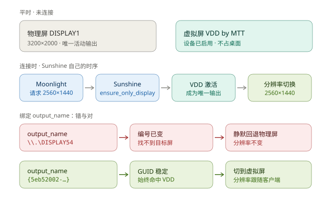

# 虚拟屏没被调用有两个坑：prep 时序，和绑了 DISPLAY 编号

**TL;DR**：虚拟屏"连上了但没生效"有两条独立原因。① 用 `global_prep_cmd` 切屏——它在显示配置和编码器探测之后才执行，会让 launch 卡死、客户端连接失败。② 把 `output_name` 写成 `\\.\DISPLAYn`——编号在设备重新启用后会变，Sunshine 找不到就静默回退物理屏，连接成功但分辨率怎么选都不变。



## 现象（2026-11-24 实测）

`redmibookpro15x` 上配了：

```text
dd_configuration_option = disabled
output_name =
global_prep_cmd = [{"do":"powershell ... Switch-Vdd.ps1 -Mode connect","undo":"... -Mode disconnect","elevated":true}]
```

Moonlight 点卡片后连接失败。日志证据：

```text
[00:05:24.995] Info: Encoder reenumeration is required
[00:05:25.116] Info: Desktop resolution [3200x2000]
[00:05:25.588] Info: [D3D11VA @ ...] AMF via D3D11.
（此后无任何输出）
```

- 没有 `Executing Do Cmd`；
- 没有 `New streaming session started`；
- `switch-vdd.log` 没有本次 connect 记录。

探测序列缺了收尾的 `Found H.264 encoder`，说明卡在 `probe_encoders()` 里。

## 根因一：顺序不对

`src/nvhttp.cpp` 的 `launch()`：

```text
display_device::configure_display(config::video, *launch_session);
video::probe_encoders();
proc::proc.execute(appid, launch_session);   // app 的 prep-cmd 在这里
```

prep 命令最后才跑。等它执行时：

- `configure_display` 已经按旧配置处理完；
- `probe_encoders` 已经按物理屏挑好编码器并初始化捕获。

此时再 `DisplaySwitch /external` 切到虚拟屏，捕获与编码参数都对不上，连接必然失败。

## 根因二：`disabled` 会触发回滚

`src/display_device.cpp`：

```text
if (const auto *disabled { std::get_if<configuration_disabled_tag_t>(&result)}; disabled) {
    revert_configuration();
    return;
}
```

`revert_configuration()` 用 `try_indefinitely_with_delay`，默认 3 秒延迟后在后台反复尝试恢复显示配置。它和 `probe_encoders()` 同时操作 DXGI 设备，探测被卡住——日志正停在探测中途。

**所以 `dd_configuration_option = disabled` 并不等于"Sunshine 完全不碰显示"**，它仍会主动回滚。

## 正确做法

```text
dd_configuration_option = ensure_only_display
output_name = \\.\DISPLAY54        # 虚拟屏编号
# 不写 global_prep_cmd
```

配套状态：

- 虚拟屏**设备常驻启用**（`ConfigFlags=0`），保证 `probe_encoders` 能找到它；
- 桌面拓扑平时只留物理屏（`DisplaySwitch /internal`），虚拟屏存在但不占桌面；
- 连接时由 Sunshine 的 `ensure_only_display` 切到虚拟屏，断开时回滚。

这与 [按需虚拟屏选型](按需虚拟屏选型.md) 的原结论相反——那一版低估了 prep 的时序约束，以本页为准。

## 第二个坑：`output_name` 绑了 DISPLAY 编号

改完 prep 之后又踩了一次：连接能建立、日志有 `CLIENT CONNECTED`，但虚拟屏没被调用、分辨率怎么选都不变。

原因：`output_name = \\.\DISPLAY54`。设备重新启用后 Windows 会重新编号（实测出现过 52 / 53 / 54），Sunshine 找不到这个 output，就静默回退到默认显示（物理屏）。日志里 `Desktop resolution [3200x2000]` 就是证据——捕获的是物理屏。

**Windows 上 `output_name` 要填 `device_id`（GUID），不是 `display_name`。** 启动日志里有：

```text
"device_id": "{5eb52002-659f-5729-bdd8-9cdc4efd1bf5}",
"friendly_name": "VDD by MTT",
```

`device_id` 由 EDID 派生，跨重启稳定；`\\.\DISPLAYn` 只是本次会话的枚举结果。`Install-Vdd.ps1` 现在装完驱动会重启服务并从日志解析这个 GUID，取不到才退回编号并告警。

查当前设备列表：

```powershell
$log = "$env:ProgramFiles\Sunshine\config\sunshine.log"
Select-String -LiteralPath $log -Pattern 'Currently available display devices' -Context 0,40 |
  Select-Object -Last 1
```

## 怎么验证

1. `sunshine.log` 出现 `Executing Do Cmd` → 说明你还在用 prep 方案，没改对；
2. 连接后日志应有 `New streaming session started` 与 `CLIENT CONNECTED`；
3. 断开后 10 秒内物理屏恢复，`dxgi-info` 里只剩 `\\.\DISPLAY1`。

## 代价

- 虚拟屏设备不能禁用，否则 probe 找不到它；"没连接时禁用"只能做到"不占桌面"，做不到"设备级关闭"。
- `output_name` 记的是 `\\.\DISPLAYn`，重启或重新启用设备后编号可能变，连不上时先查编号。
